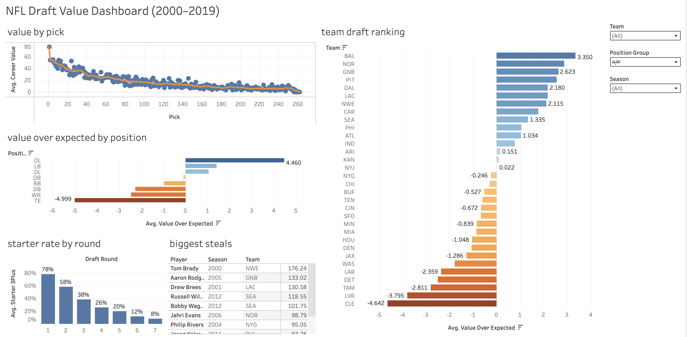
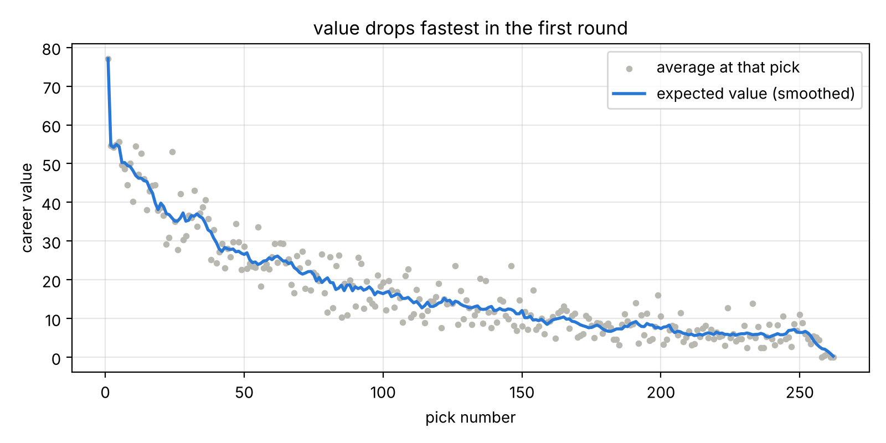
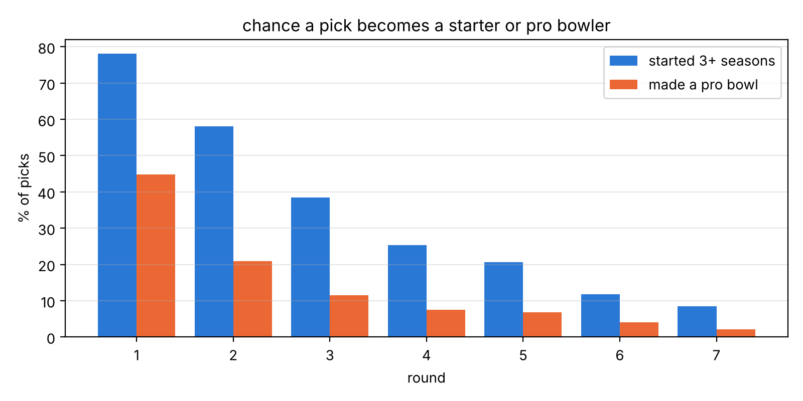
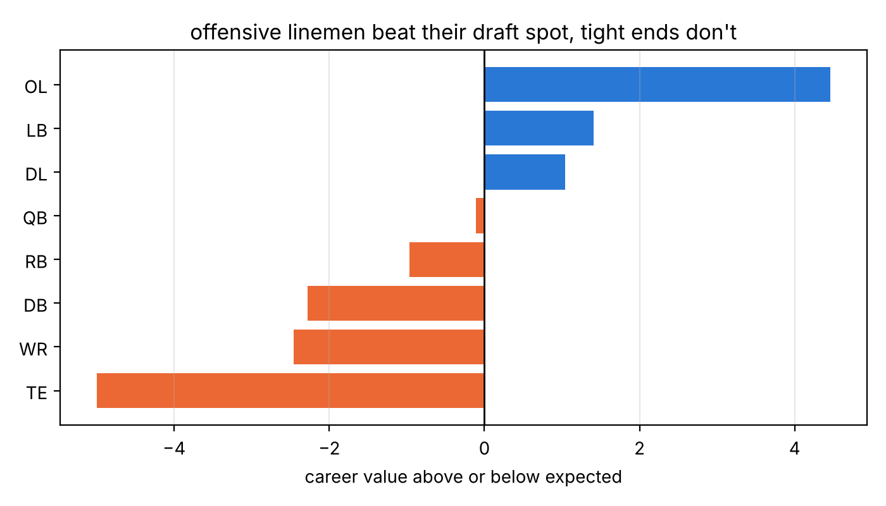
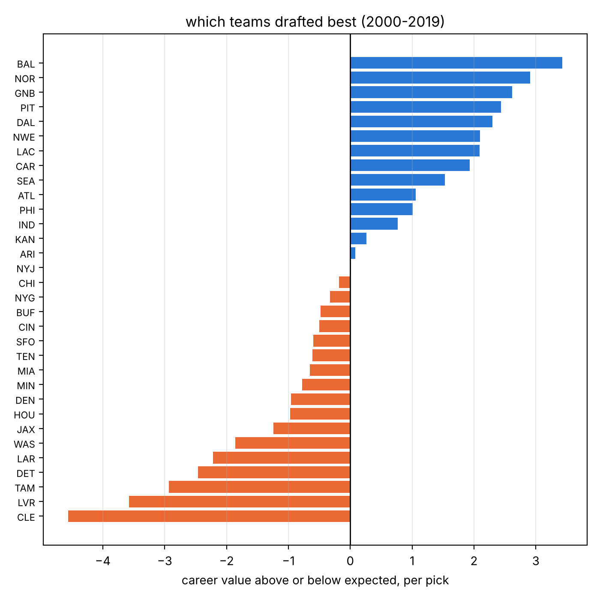

# NFL Draft Value Analysis

I wanted to see which draft picks, positions, and teams get the most value out of the NFL draft. I looked at every pick from 2000 to 2019 (5,095 players) using SQL, Python, Excel, and Tableau.

## Tableau dashboard

[View the dashboard on Tableau Public](https://public.tableau.com/app/profile/dija.w2969/viz/NFLDraftValueDashboard/NFLDraftValueDashboard20002019)

You can filter by team, position, or year, and all the charts update.



## Excel summary workbook

`nfl_draft_analysis.xlsx` has the summary tables for the project. I used Excel for the tables and Tableau for the interactive dashboard.

- Summary sheets by round, position, and team, built with formulas like `COUNTIF`, `AVERAGEIFS`, `SUMIFS`, and `RANK`
- A pivot table showing starter rate by position and round
- Expected value for each pick, looked up with `INDEX` / `MATCH`

## Data

- Draft picks from [nflverse](https://github.com/nflverse), loaded with the `nflreadpy` Python package
- I only used 2000-2019 because players drafted after that are still playing
- **Career value** = Pro Football Reference's approximate value (one number for a player's whole career)
- **Value over expected** = how much better or worse a player did than the average player picked at the same spot

## What I found

- **First round picks are way more valuable.** The #1 pick averages a career value of 77. Picks after #100 average about 9.
- **Most late picks don't work out.** 78% of first round picks started 3+ seasons, but only 8% of 7th round picks did.
- **Offensive linemen are the safest picks.** They beat their draft spot more than any other position. Tight ends and wide receivers did the worst.
- **Late round QBs almost never work out.** Only 8% of QBs from rounds 4-7 started 3+ seasons. Tom Brady (pick #199) is the biggest steal in the data.
- **Baltimore drafted the best.** Then New Orleans, Green Bay, and Pittsburgh. Cleveland drafted the worst.

## Charts






## Files

- `clean_data.py` - loads and cleans the data, saves it to a SQLite database
- `sql/views.sql` - calculates the expected value for each pick
- `sql/analysis.sql` - the SQL queries I used to answer my questions
- `analysis.py` - runs the queries and makes the charts
- `build_excel.py` - makes the Excel summary workbook (`nfl_draft_analysis.xlsx`)

## How to run

```
pip install -r requirements.txt
python clean_data.py
python analysis.py
python build_excel.py
```

## Tools

SQL, Python (pandas, matplotlib), Excel, Tableau
